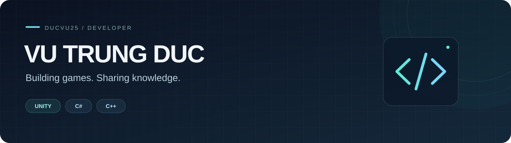

  

  
  

## A little about me

Hi, I'm **Vu Trung Duc** — a developer focused on **Unity, C# and C++**.

I enjoy building 2D games, exploring gameplay systems, and sharing programming resources. My repositories bring together game projects, hands-on experiments, and materials for learning C/C++ and algorithms.

- **Current focus:** Unity 2D and C# gameplay programming.
- **Core interests:** game development, data structures, algorithms, and SQL.
- **Open to:** collaborating on projects and helping others learn programming.

## Toolbox

  
  
  
  
  
  
  

## Selected projects

| Project | Explore |
| :--- | :--- |
| **[Flappy Bird · SDL2](https://github.com/ducvu25/GameFlappyBird_SDL2)** | A C++ game project built with SDL2. |
| **[Data Structures & Algorithms](https://github.com/ducvu25/CTDL-GT)** | C++ code for studying data structures and algorithms. |
| **[C/C++ Learning Resources](https://github.com/ducvu25/Tai-Lieu-C-C-)** | Programming materials for learning and practice. |

## Let's connect

Have a project idea or a programming question? **[Send me a message on Facebook →](https://www.facebook.com/profile.php?id=100022133502790)**

Building, learning, and sharing — one project at a time.
